<div align="center">

# AI Games

**Describe a world. Make it playable. Take it offline.**

An open-source game creator for iOS and Android, with an Expo app and a self-hosted AI generation backend.

[](LICENSE)
[](https://github.com/mcontre4/ai-games-open-source/actions/workflows/verify.yml)
[](package.json)

[Quick start](#quick-start) · [Screenshots](#screenshots) · [How to use it](#how-to-use-it) · [Architecture](#architecture) · [Contributing](CONTRIBUTING.md)

</div>

AI Games turns a prompt into a downloadable game: moderation, art direction, artwork, gameplay code, build, validation and a signed package. Choose **2D**, **3D** or **isometric**, then iterate with natural-language modifications. The native player stores verified games and progress on the device, so downloaded games keep working offline.

The repository includes **Neon Comet**, a deterministic Phaser sample you can play without an AI key. Real creation uses your own funded OpenRouter account through a controlled Codex CLI gateway. A failed or unconfigured generation never becomes a sample behind the scenes.

## Screenshots

Captures of the actual Expo interface and offline game runtime. Accounts, balances, library entries and generation states use **synthetic documentation fixtures**. These demonstrate the interface, not live AI generation or native-device verification. The view-selector illustrations are concept art; Neon Comet is real playable sample gameplay.

<table>
  <tr>
    <td align="center">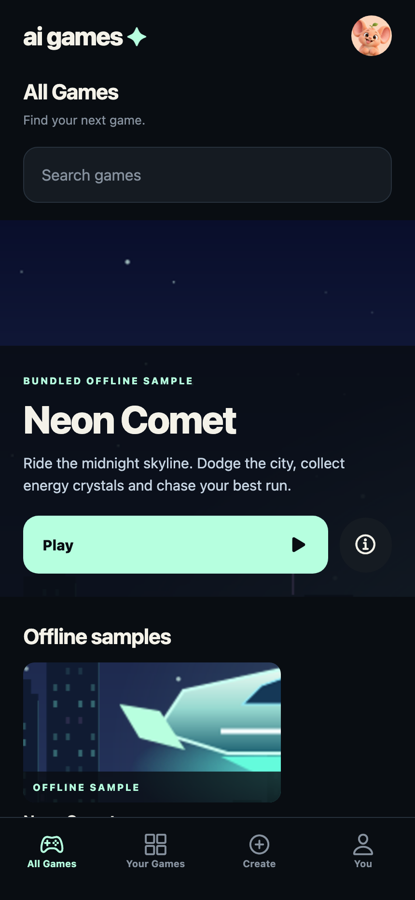<br /><b>Discover games</b></td>
    <td align="center">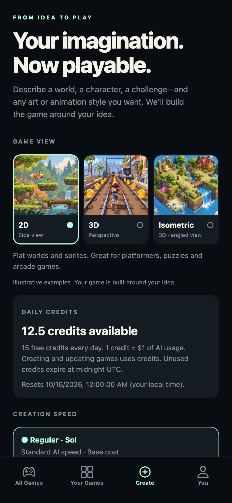<br /><b>Start with an idea</b></td>
    <td align="center"><br /><b>Play offline</b></td>
  </tr>
</table>

<details>
<summary><b>Explore the full gallery: library, prompts, progress, retries, profiles and settings</b></summary>

<table>
  <tr>
    <td>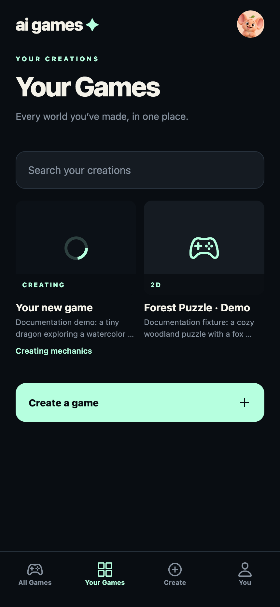<br />Your Games</td>
    <td>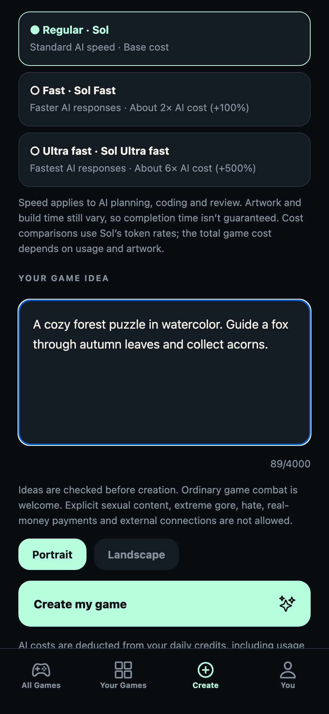<br />Prompt and controls</td>
    <td>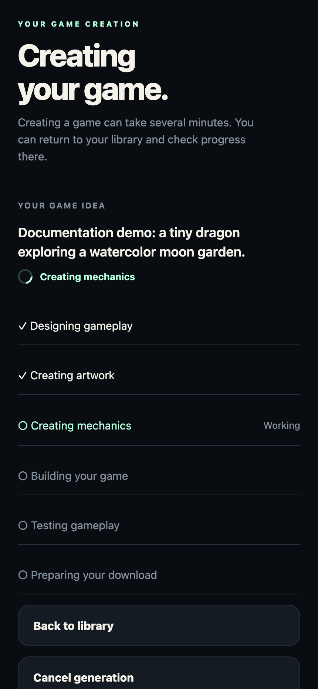<br />Creation progress</td>
  </tr>
  <tr>
    <td>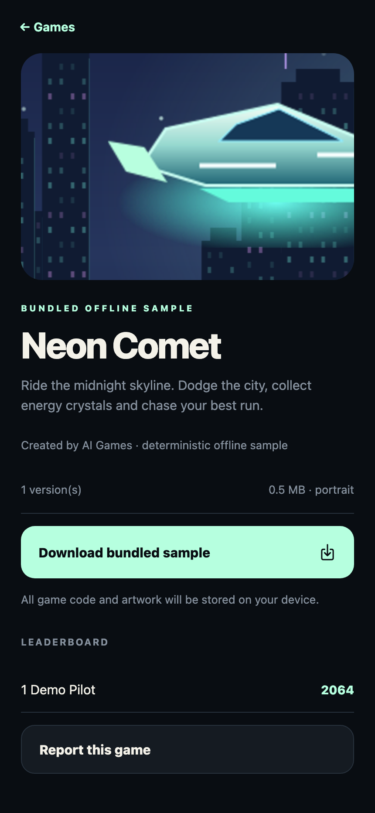<br />Versions and downloads</td>
    <td>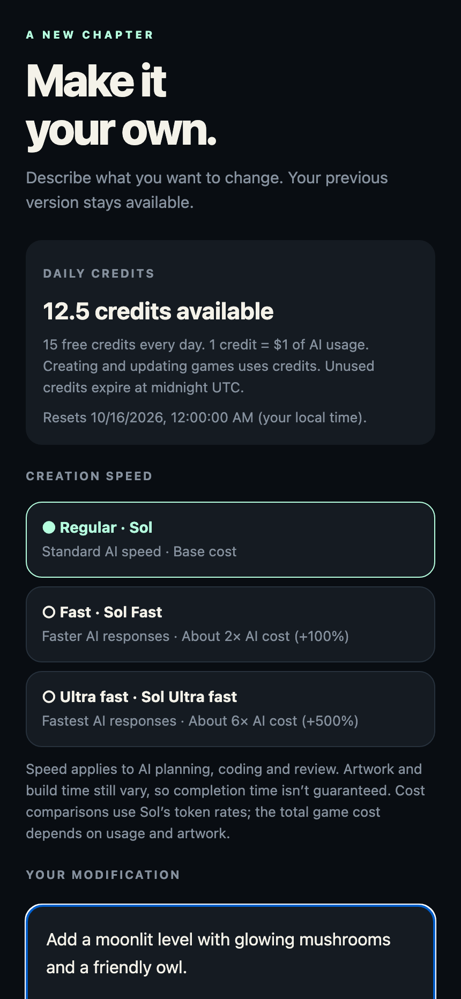<br />Modify a game</td>
    <td>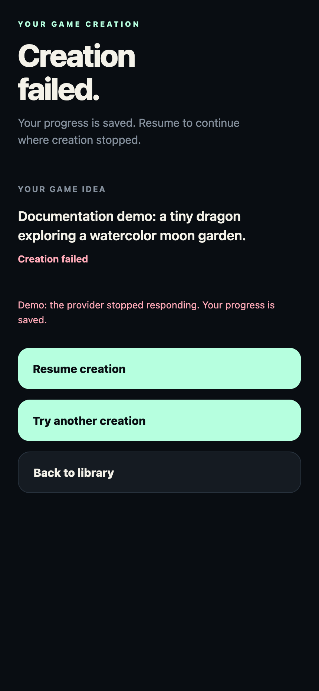<br />Resume interrupted work</td>
  </tr>
  <tr>
    <td>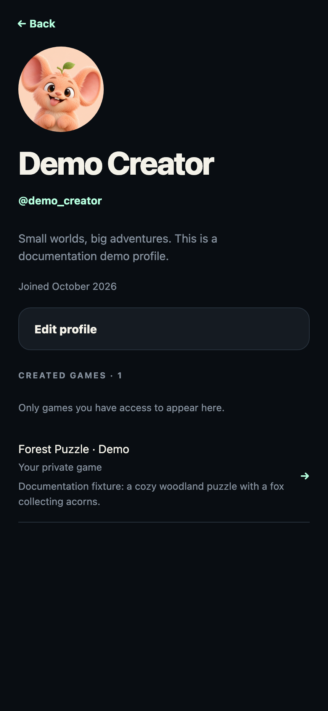<br />Creator profiles</td>
    <td>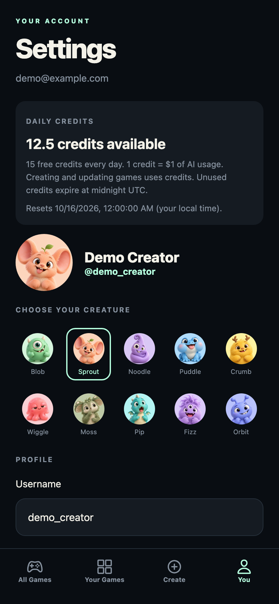<br />Account settings</td>
    <td>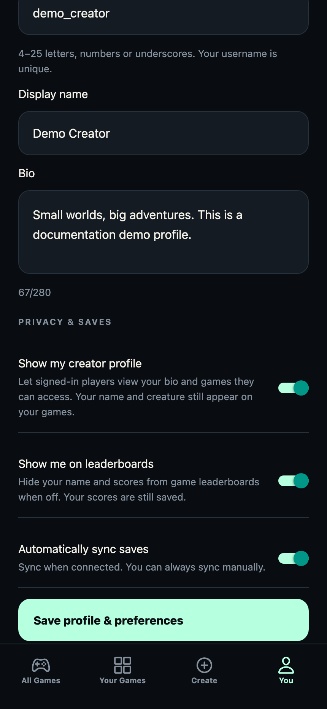<br />Privacy and saves</td>
  </tr>
  <tr>
    <td>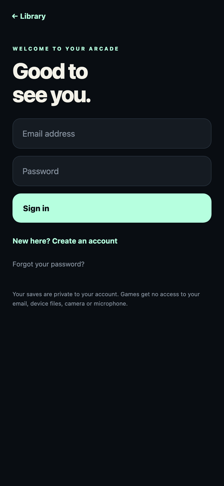<br />Authentication</td>
    <td>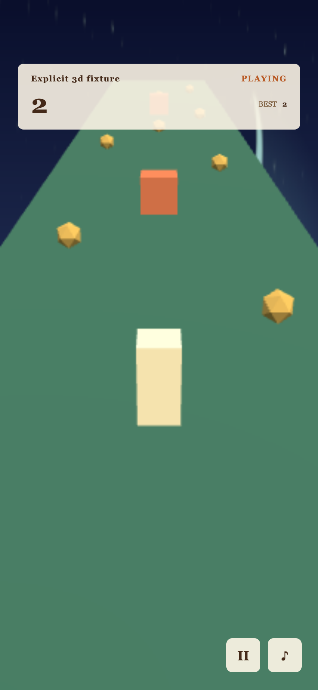<br />3D runtime fixture</td>
    <td>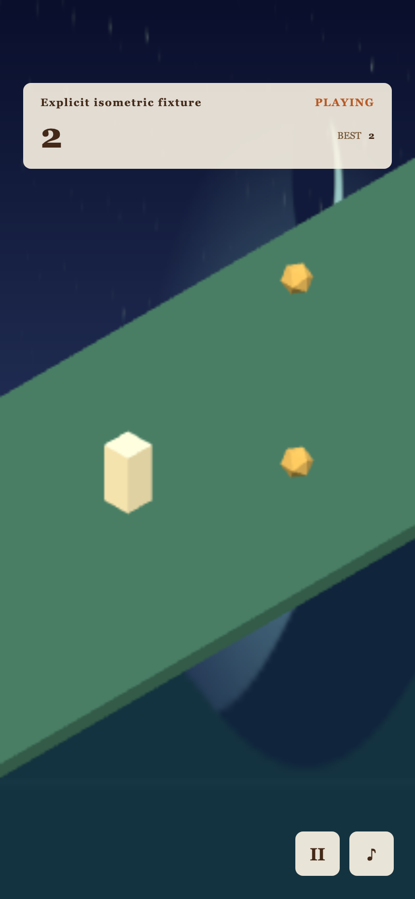<br />Isometric runtime fixture</td>
  </tr>
</table>

Regenerate with `pnpm screenshots`. See [provenance and reproduction](docs/SCREENSHOTS.md).

</details>

## Features

- **Create from a prompt:** select a view, orientation and generation speed; describe mechanics, characters and art style.
- **Iterate safely:** modifications publish immutable versions; generation checkpoints preserve work for retries.
- **Play offline:** Ed25519 signatures and asset hashes are verified before installation; progress lives in account-scoped SQLite.
- **Sync progress:** revision-aware cloud saves retain conflicts for explicit recovery.
- **Keep guest creations:** sign up or sign in on the same device to transfer ownership and usage.
- **Share and manage access:** invitations, creature profiles, casual leaderboards, blocking, reporting, data export and account deletion.
- **Self-host:** API, worker, database migrations and isolated build infrastructure are included. PostHog telemetry is optional and disabled by default.

## Quick start

### Requirements

| Tool                                             | Needed for                                                 |
| ------------------------------------------------ | ---------------------------------------------------------- |
| Node **22.12+**, **pnpm 11.25.0**                | TypeScript workspace; use the pinned package manager       |
| Docker with a running daemon                     | Local Supabase, generation sandboxes and integration tests |
| Xcode, command-line tools and CocoaPods on macOS | iOS development builds                                     |
| Java **17+**, Android SDK and emulator/device    | Android development builds                                 |
| Playwright Chromium                              | Game validation, browser tests and screenshots             |
| Your own funded OpenRouter key                   | Optional: real AI creation and modification                |

Allow several GB for dependencies, native builds and containers. Expo Go lacks the required custom native modules; use a development build.

### 1. Install and configure

```sh
git clone https://github.com/mcontre4/ai-games-open-source.git
cd ai-games-open-source
pnpm install --frozen-lockfile
pnpm exec playwright install chromium
pnpm dev:infra
pnpm setup:local
pnpm db:migrate
pnpm fixture:build
pnpm fixture:seed
```

On Linux, use `pnpm exec playwright install --with-deps chromium`. Setup creates ignored `.env.development` files and independent Ed25519 signing keys. It retrieves credentials from your local Supabase containers and copies only supported public settings to mobile. It adds no AI key and does not contact the maintainer's deployment. Fixture seeding rebuilds and signs the sample with your local key, updating its bundled ZIP, public metadata and cover; private keys remain ignored.

### 2. Start the app

```sh
pnpm dev
```

In another terminal, build and install one native development client:

```sh
pnpm ios       # macOS + Xcode
# or
pnpm android  # Java + Android SDK
```

Open **All Games → Neon Comet → Download bundled sample → Play game**. The sample needs no AI key. You can explore accounts, downloads and local saves before enabling generation.

For later sessions, `pnpm dev:ios` / `pnpm dev:android` starts Metro on localhost:8084 and opens an already installed client without rebuilding. Keep one Metro instance running; stop the Metro process launched by `pnpm dev` before starting a separate mobile command. Alternatively run `pnpm dev:api`, `pnpm dev:worker` and `pnpm dev:mobile` in separate terminals. Rebuild after native dependency changes.

Android emulators map loopback to `10.0.2.2`; physical devices need reachable development URLs. The web export previews app UI; native offline gameplay requires iOS/Android. The screenshot harness runs independently of the backend.

### 3. Enable AI generation (optional, paid)

```sh
pnpm sandbox:build
```

Using an editor, add **your own** funded `OPENROUTER_API_KEY` to root `.env.development`, then restart API and worker. Never put it in a mobile file or an `EXPO_PUBLIC_*` variable. A ChatGPT subscription does not supply this key. No host Codex login is required: the pinned CLI runs inside the sandbox through the trusted gateway.

The provider must support the configured coding, moderation and image models. The default image provider may require the account owner to confirm 18+ eligibility in OpenRouter preferences. The app separately requires 16+ user self-attestation. See [provider setup](docs/LOCAL_DEVELOPMENT.md) and [generation speeds](docs/GENERATION_SPEED.md).

New installations enable estimated-cost reservations, **$10/job**, **$100/UTC day** server caps, account quotas, credit accounting and API rate limits. Choose smaller budgets and an independent provider-side spending limit before funding a key. These are operator-funded limits, not a free hosted AI service. The default allowance is 15 internal daily credits; one credit represents $1 of measured provider usage. Faster routes can cost more. Billed usage before failure or cancellation still counts.

`pnpm test:generation:live` performs paid creation and modification; `pnpm test:moderation:live` performs a separate paid classifier evaluation. Neither is included in normal tests or CI.

## How to use it

1. **Try the sample.** Download Neon Comet, start flying, drag to steer and collect crystals. Pause/restart from the player; best scores persist locally.
2. **Create a world.** Select view, speed and orientation, then describe the character, challenge and style. Submit after confirming the age requirement; a guest session is created if needed.
3. **Follow progress.** Your Games retains the prompt and status. Moderation, art, coding, build, validation and packaging run in sequence. An error remains visible; saved work may offer Resume creation or Retry creation.
4. **Download the result.** Open details and download a completed version. The host verifies the package before play. Installed versions work offline.
5. **Make a change.** Use a focused modification prompt, such as “add a moonlit level with glowing mushrooms.” Your previous version stays available.
6. **Keep and share your work.** Sign up/sign in on the same device to claim guest games. Set your username, creature and privacy preferences. Send an invitation from game details. Revocation controls future online access; downloaded copies can remain offline.
7. **Manage data.** Settings includes save sync, conflict recovery, download removal, blocked creators, export and account deletion. Offline leaderboards are casual, not cheat-proof.

## Architecture

```text
Expo app ── authenticated HTTP ── Fastify API ── PostgreSQL / Supabase Auth
   │                                  │                    │
   │ signed ZIP download              └── persistent jobs ─┤
   ▼                                                       ▼
Native installer / SQLite                              Trusted worker
   │                                                       │
   ▼                                     moderate → art → isolated coding
Restricted WebView game runtime                 → build → validate → sign
   │                                                       │
   └── scoped GameSDK: progress / scores         Private artifact storage
```

Games and generated source are untrusted. The host owns authentication, storage and synchronization. Agent containers receive short-lived scoped grants instead of provider credentials. Domain rules import no infrastructure or UI; application owns use cases and ports, adapters implement them, and presentation composes behavior.

| Directory                                     | Purpose                                                          |
| --------------------------------------------- | ---------------------------------------------------------------- |
| `apps/mobile`                                 | Expo Router UI, native installer, SQLite and restricted player   |
| `apps/api`, `apps/worker`                     | HTTP API and persistent generation worker                        |
| `packages/domain`, `packages/application`     | Pure rules, use cases and ports                                  |
| `packages/adapters`, `packages/contracts`     | Infrastructure and strict schemas                                |
| `packages/game-sdk`, `packages/game-template` | Restricted bridge, verifier and sample                           |
| `infrastructure`                              | SQL/RLS migrations, Supabase and sandbox image                   |
| `tests`                                       | Unit/security, integration, browser, screenshot and native flows |

Details: [Architecture](docs/ARCHITECTURE.md), [API](docs/API.md), [GameSDK](docs/GAME_SDK.md), [signed packages](docs/GAME_PACKAGE_SPEC.md), [game views](docs/GAME_VIEWS.md) and [security boundaries](docs/SECURITY.md).

## Development commands

| Command                                    | Purpose                                                        |
| ------------------------------------------ | -------------------------------------------------------------- |
| `pnpm dev:infra` / `pnpm stop:infra`       | Start/stop local services without deleting data                |
| `pnpm setup:local`                         | Generate local configuration and signing keys                  |
| `pnpm db:migrate`                          | Apply local SQL migrations                                     |
| `pnpm dev`                                 | Start API, worker and Expo together                            |
| `pnpm ios` / `pnpm android`                | Build native development client                                |
| `pnpm dev:ios` / `pnpm dev:android`        | Metro for an installed client                                  |
| `pnpm fixture:build` / `pnpm fixture:seed` | Rebuild/re-sign/reseed sample; updates bundled fixture files   |
| `pnpm sandbox:build`                       | Build isolated generation image                                |
| `pnpm verify`                              | Typecheck, lint, unit/security, integration and browser checks |
| `pnpm test:mobile`                         | Separate Maestro flows; needs Maestro and a running native app |
| `pnpm screenshots`                         | Reproduce screenshots without real accounts or live AI         |
| `pnpm secrets:check`                       | Redacted history scan; requires Gitleaks 8.30.1+               |

Integration checks need local Supabase and the sandbox image. Stop your development worker while testing so it cannot consume fixture jobs. See [verification setup and evidence](docs/TESTING.md).

## Deploy your own instance

Production requires your own server `.env.production` and local `apps/mobile/.env.production`. Start from [the server template](.env.production.example) and [public mobile template](environments/production.mobile.env.example). EAS gets public values from **your** project's production environment. There is no bundled hosted backend or maintainer credential.

Use separate production credentials, private persistent artifacts, least-privilege database roles, HTTPS, a dedicated Docker worker and real Apple/Google verification. See [deployment](docs/DEPLOYMENT.md), [environment separation](docs/ENVIRONMENTS.md), [app integrity](docs/APP_INTEGRITY.md) and [optional analytics](docs/ANALYTICS.md).

## Troubleshooting

| Symptom                        | What to check                                                                   |
| ------------------------------ | ------------------------------------------------------------------------------- |
| “No development servers found” | Start Metro with `pnpm dev:ios` / `pnpm dev:android`; avoid duplicate instances |
| Missing native module          | Build a custom client; rebuild after native dependency changes                  |
| API/Auth unavailable           | Docker, local setup, migrations and API must be running                         |
| Device cannot reach localhost  | Use emulator mapping or reachable development host URLs                         |
| AI unavailable                 | Fund a server-only key, confirm model/provider access, restart API/worker       |
| Missing production settings    | Fill your ignored production files or EAS environment                           |
| Test port occupied             | Set `CREATION_UI_PORT`, `PROFILE_UI_PORT` or `SCREENSHOT_UI_PORT`               |

## Status, contributing and license

This is an evolving self-hosted MVP. It does not claim a completed store release, universal-link deployment, penetration test or full native-attestation verification. Device testing, production operations and paid end-to-end generation remain separate release work. See [current verification](docs/TESTING.md) and [implementation notes](docs/IMPLEMENTATION.md).

Contributions are welcome: [CONTRIBUTING.md](CONTRIBUTING.md). Report bugs and feature ideas in [Issues](https://github.com/mcontre4/ai-games-open-source/issues); disclose vulnerabilities [privately](SECURITY.md). Never attach credentials, private accounts or raw provider responses.

[MIT](LICENSE) © 2026 AI Games contributors. Dependencies retain their own licenses; see [third-party notices and asset provenance](THIRD_PARTY_NOTICES.md).
